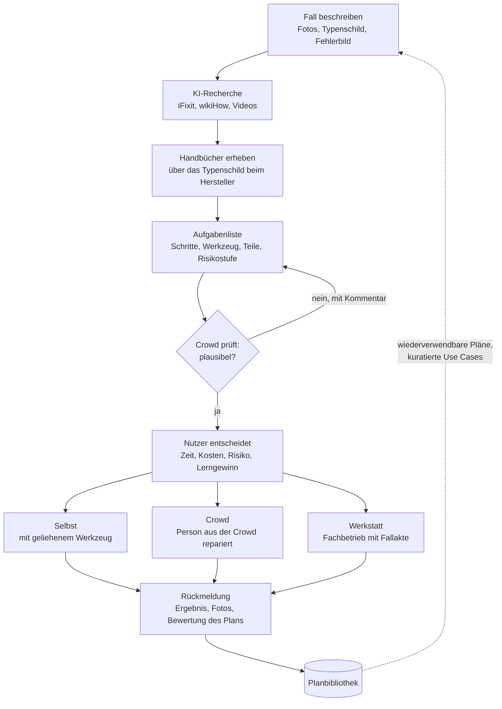

# Wie repariere ich XY? – DIY-Reparatur-Lernplattform

Proof of Concept (PoC) und Prototyp für eine Lernplattform, die zu einem kaputten Objekt oder einem Vorhaben einen geprüften Reparaturplan erstellt und den Weg zur Ausführung vermittelt.

> **Status:** Konzeptphase, privates Repository · Stand: 20.11.2026
>
> **Konzeptdokument:** [Konzept: DIY-Reparatur-E-Learning „Wie repariere ich XY?“](https://claude.ai/artifact/CkPrLuHiYxptk8w6C2RDn7)

---

## 1. Idee in Kürze

Nutzer stellen die Frage „Wie repariere ich XY?“. Eine KI recherchiert, erhebt die Benutzerhandbücher und erstellt eine Aufgabenliste. Eine Crowd plausibilisiert den Plan. Danach entscheidet der Nutzer, ob er selbst repariert, mit eigenem oder geliehenem Werkzeug, oder ob jemand aus der Crowd oder eine Werkstatt die Reparatur übernimmt. Werkzeugverleih, Crowd-Einsätze und Werkstätten kommen über eine Nachbarplattform.

Gelernt wird am Fall: Fehlerbild, Arbeitsschritte und Risiken werden verstanden, bevor entschieden wird, wer repariert. Neben realen Fällen können Nutzer beliebige Use Cases beschreiben oder vorgegebene Use Cases durcharbeiten.

**Abgrenzung (Annahme):** Die Plattform ist Lern-, Planungs- und Vermittlungssystem. Reparaturen, Werkzeugverleih und Werkstattleistungen erbringen Dritte über die Nachbarplattform.

**Anspruch „zuverlässig und schnell“:** Das ist eine Zielanforderung, keine Eigenschaft. Sie wird über die Messgrößen in [Abschnitt 4](#4-was-der-poc-beweisen-soll) überprüft.

## 2. Ablauf

Kein Plan geht ohne Crowd-Freigabe in die Ausführung. Abgeschlossene Fälle füllen die Planbibliothek. Daraus entstehen vorgegebene Use Cases und schnellere Prüfungen bei gleichem Modell und Fehlerbild.

## 3. Rollen und Lernmodi

| Rolle | Was sie tut | Was sie davon hat |
| --- | --- | --- |
| Nutzer | beschreibt Fall oder Vorhaben, lernt, entscheidet über die Ausführung | geprüfter Plan, Verständnis des Fehlers, Entscheidungsgrundlage |
| Crowd-Prüfer | plausibilisiert Pläne, ergänzt Risiken und Erfahrungswerte | Reputation, gegebenenfalls Vergütung |
| Crowd-Ausführende | übernehmen Reparaturen | Aufträge über die Nachbarplattform |
| Werkstätten | übernehmen Fälle mit vorbereiteter Fallakte | vorqualifizierte Anfragen |
| Werkzeugverleih (Nachbarplattform) | stellt Werkzeug zur Leihe bereit | Buchungen direkt aus Aufgabenlisten |
| Inhaltsquellen | liefern Handbücher und Anleitungen | Verlinkung, Reichweite, gegebenenfalls Lizenzentgelt |
| Kuratoren | erstellen und pflegen vorgegebene Use Cases | Sichtbarkeit, gegebenenfalls Honorar |

| Lernmodus | Ausgangspunkt | Endet mit | Crowd-Prüfung |
| --- | --- | --- | --- |
| Realer Fall | kaputtes Objekt: Fotos, Typenschild, Fehlerbild | Durchführung und Rückmeldung | verpflichtend |
| Freier Use Case | beliebig beschriebenes Vorhaben, auch hypothetisch | Plan und Lerneinheit; als „nicht objektspezifisch“ gekennzeichnet | optional |
| Vorgegebener Use Case | kuratierter Fall aus dem Katalog | Lernpfad mit Prüffragen und Abschlussnachweis | bereits erfolgt |

## 4. Was der PoC beweisen soll

Der PoC prüft die Kernannahme: KI-Recherche plus Crowd-Prüfung ergibt rasch einen verlässlichen, objektspezifischen Plan. Werkzeugverleih und Buchungen sind nicht Teil des PoC.

| # | Hypothese | Messgröße | Zielwert |
| --- | --- | --- | --- |
| H1 | Die KI erstellt für Geräte mit Typenschild einen objektspezifischen Plan, in dem jeder Schritt eine Quelle hat. | Anteil der Schritte mit passender Quelle | offen |
| H2 | Der KI-Plan ist überwiegend richtig. | Anteil der Pläne, die die Crowd-Prüfung ohne inhaltliche Korrektur passieren | offen |
| H3 | Die Crowd-Prüfung ist schnell genug. | Zeit vom erfassten Fall bis zum plausibilisierten Plan | offen |
| H4 | Mit dem geprüften Plan gelingt die Reparatur. | Anteil der Fälle mit gemeldeter erfolgreicher Reparatur | offen |

**Umfang**

- eine Gerätekategorie der Risikostufe 1 oder 2 (Auswahl offen)
- Testfälle von eingeladenen Nutzern (Anzahl offen)
- kleine, eingeladene Prüfergruppe mit einfacher Prüfmaske
- Ausführung durch die Testnutzer selbst, außerhalb des Systems; erfasst wird nur die Rückmeldung
- Quellen werden verlinkt, Volltexte nicht gespeichert

**Nicht im PoC:** Werkzeugverleih, Crowd- und Werkstattbuchung, Zahlungen, Risikostufe 3, Reputationssystem, mobile App.

**Ergebnis:** Auswertung der vier Messgrößen und Entscheidung, ob der Prototyp gebaut wird.

## 5. Prototyp

Der Prototyp folgt nur, wenn der PoC die Hypothesen trägt. Er bildet den ganzen Ablauf ab, mit angebundener oder simulierter Nachbarplattform.

| Baustein | PoC | Prototyp |
| --- | --- | --- |
| Fallaufnahme (Fotos, Typenschild, Fehlerbild) | einfaches Formular | geführte Erfassung inkl. Produktgruppe und Kaufdatum, mobil nutzbar |
| KI-Recherche mit Quellenliste | ja | ja |
| Handbuchsuche | Links, manuell unterstützt | automatisiert über das Typenschild |
| Aufgabenliste mit Risikostufe | ja | ja |
| Crowd-Prüfung | eingeladene Gruppe, einfache Prüfmaske | Zuteilung nach Gerätekategorie, Reputation, Interessenkonflikt-Regel |
| Entscheidungsansicht | statische Gegenüberstellung | Optionen mit Zeit, Kosten, Risiko, Lerngewinn |
| Werkzeugverleih | – | Leih-Link zur Nachbarplattform (Partner-Schnittstelle oder Attrappe) |
| Crowd- und Werkstattbuchung | – | Übergabe der Fallakte an die Nachbarplattform |
| Lernmodi | realer Fall | realer Fall, freier Use Case, vorgegebene Use Cases |
| Planbibliothek | Ablage der Testfälle | Wiederverwendung bei gleichem Modell und Fehlerbild |
| Risikostufe 3 | ausgeschlossen | nur Hinweis und Weg zur Werkstatt |
| Kennzeichnung „KI-Entwurf“ / „von der Crowd geprüft“ | ja | ja |
| Zahlungen | – | – |

## 6. Architektur (Vorschlag)

| Baustein | Aufgabe |
| --- | --- |
| Fallaufnahme | erfasst Fotos, Typenschild, Fehlerbild, Produktgruppe, Kaufdatum |
| Recherche-Dienst | KI-Recherche über die Quellenadapter, Synthese mit Quellenliste |
| Quellenadapter | iFixit über die API, Herstellerseiten als Link, wikiHow und Videos nur als Link |
| Plan-Generator | Aufgabenliste mit Schritten, Werkzeug, Teilen, Risikostufe und Quelle je Schritt |
| Prüf-Workflow | Zuteilung, Prüfmaske, Ergebnis „freigegeben“, „freigegeben mit Korrekturen“ oder „zurück an die KI“ |
| Entscheidungsansicht | stellt selbst, Crowd und Werkstatt nebeneinander |
| Planbibliothek | freigegebene Pläne und Katalog-Kandidaten |
| Adapter Nachbarplattform | Werkzeugleihe, Crowd- und Werkstattbuchung (erst im Prototyp) |

**Technologie-Stack:** offen. Die Entscheidung wird vor Beginn des PoC getroffen und hier dokumentiert.

**Kernobjekte**

| Objekt | Wichtige Felder |
| --- | --- |
| Fall | Lernmodus, Fotos, Typenschild, Fehlerbild, Produktgruppe, Kaufdatum |
| Quelle | Typ, URL, Lizenz, Abrufdatum |
| Plan | Fall, Version, Status („KI-Entwurf“ / „von der Crowd geprüft“), Risikostufe |
| Schritt | Reihenfolge, Beschreibung, Warum, Werkzeug, Teile, Sicherheitshinweis, Quelle |
| Prüfung | Plan, Prüfer, Ergebnis, Kommentar, Zeitstempel |
| Option | Plan, Art (selbst / Crowd / Werkstatt), Zeit, Kosten, Risiko, Lerngewinn |
| Rückmeldung | Fall, Ergebnis, Fotos, Bewertung des Plans |
| Use Case | Quellfall, Lernpfad, Prüffragen |

## 7. Qualitätssicherung und Risikostufen

| Stufe | Beispiele | Prüfung | Selbstreparatur |
| --- | --- | --- | --- |
| 1 – niedrig | Möbel, Textilien, Fahrrad-Standardwartung, Geräte ohne Netzspannung | ein Prüfer | angeboten |
| 2 – mittel | netzbetriebene Geräte mit geöffnetem Gehäuse, Sanitär ohne Eingriff in Leitungen | zwei unabhängige Prüfer, davon einer mit Fachnachweis | angeboten nach verpflichtendem Sicherheitscheck |
| 3 – hoch | fixe Elektroinstallation, Gas, Mikrowellen, große Lithium-Akkus, Kältemittelkreisläufe, Fahrzeugbremsen, tragende Bauteile | Fachprüfer verpflichtend | nur soweit rechtlich zulässig; Standard ist Werkstatt oder Fachbetrieb |

- **Prüfpunkte je Schritt:** Quelle passt zum Modell, Reihenfolge stimmt, Werkzeug ist richtig, Sicherheitshinweise sind vollständig, Aufwand ist realistisch.
- **Reputation** folgt dem Ergebnis, nicht der Aktivität.
- **Interessenkonflikt:** Wer einen Plan prüft, darf denselben Fall nicht ausführen.
- **Geschwindigkeit:** Zuteilung nach Gerätekategorie, feste Prüffenster, Wiederverwendung freigegebener Pläne aus der Planbibliothek.

## 8. Externe Quellen und Lizenzen

Grundsatz: verlinken statt übernehmen. Die großen offenen Reparaturquellen sind nicht für kommerzielle Nutzung freigegeben.

| Quelle | Lizenz / Rechte | Nutzung |
| --- | --- | --- |
| Herstellerhandbücher | urheberrechtlich geschützt, je Hersteller | Deep-Link auf das Original; Volltext nur über Kooperation |
| iFixit | CC BY-NC-SA 3.0; kommerzielle Nutzung nur mit gesonderter Lizenz | über die API abrufen, auf das Original verlinken; Lizenz anfragen, falls Inhalte eingebettet werden |
| wikiHow | Texte vor 24.03.2025: CC BY-NC-SA 3.0; neuere Texte proprietär | nur verlinken |
| Europäische Online-Plattform für Reparaturen | für Verbraucher kostenlos; Schnittstelle der Kommission bis 31.07.2027 | Quelle für Werkstätten, sobald verfügbar |
| Regionale Reparaturverzeichnisse (reparaturnetzwerk.at, reparaturfuehrer.at, grazrepariert.at) | je Betreiber | Werkstattsuche; Kooperation prüfen |
| Video-Plattformen, Foren | je Urheber | nur Verlinkung |

## 9. Rechtliche Leitplanken (Österreich/EU)

Diese Übersicht ersetzt keine Rechtsberatung.

- **Recht auf Reparatur:** Das Warenreparaturrichtlinie-Umsetzungsgesetz (BGBl. I Nr. 60/2026) gilt seit 01.10.2026. Für Produktgruppen aus Anhang II der RL (EU) 2024/1799 muss der Hersteller reparieren, auch außerhalb der Gewährleistung. Die Fallaufnahme fragt deshalb Produktgruppe und Kaufdatum ab.
- **Gewährleistung:** Eine Reparatur als Gewährleistungsbehelf in den ersten zwei Jahren verlängert die Gewährleistung einmalig um ein Jahr. Vor jeder Selbstreparatur in dieser Frist erscheint ein Hinweis.
- **Gewerberecht:** Bezahlte, regelmäßige Crowd-Einsätze brauchen eine Gewerbeberechtigung; reglementierte Gewerbe zusätzlich eine Befähigung.
- **Elektrotechnik:** Fixe Installation ist immer Risikostufe 3 (§ 12 ETG 1992; Grenzen für Laien an der eigenen Anlage prüfen).
- **Haftung und Plattformrecht:** Haftungsausschlüsse gegenüber Verbrauchern sind nur eingeschränkt wirksam. Pflichten aus dem Digital Services Act für Online-Marktplätze prüfen.
- **KI und Daten:** Pläne als „KI-Entwurf“ bzw. „von der Crowd geprüft“ kennzeichnen. Fotos zeigen Wohnungen, Typenschilder und teils Personen, daher Datensparsamkeit nach DSGVO.
- **Förderungen** sind nicht als Erlös eingeplant. Die Geräte-Retter-Prämie läuft Ende 2026 aus.

## 10. Business Model Canvas

| Feld | Inhalt |
| --- | --- |
| Schlüsselpartner | Nachbarplattform (Werkzeugverleih, Crowd, Werkstätten), Hersteller (Handbücher), iFixit und wikiHow (Lizenz bzw. Link), Repair Cafés und Reparaturnetzwerke, KI-Anbieter, Versicherer |
| Kernaktivitäten | KI-Recherche und Planerstellung, Crowd-Prüfung, Use Cases kuratieren, Risikostufen und Sicherheitschecks |
| Kernressourcen | Planbibliothek, Use-Case-Katalog, Crowd mit Reputationsdaten, KI-Pipeline und Quellenindex |
| Wertangebot | Für Nutzer: geprüfter Plan für das eigene Objekt; verstehen, bevor repariert wird; Wahl zwischen selbst, Crowd und Werkstatt; Werkzeug leihen statt kaufen. Für Anbieter: vorqualifizierte Fälle mit Fallakte; Reputation durch gute Ergebnisse |
| Kundenbeziehungen | Selbstbedienung mit KI, Community mit Reputation, Video-Begleitung bei Bedarf, Lernnachweise |
| Kanäle | Suchmaschinen („Wie repariere ich XY?“), Web-App (mobil), Nachbarplattform, Repair Cafés und Reparaturnetzwerke |
| Kundensegmente | Heimwerker mit konkretem Defekt, Lernende ohne Vorerfahrung, Crowd (Prüfer und Ausführende), Werkstätten |
| Kostenstruktur | KI-Nutzung pro Fall, Vergütung der Crowd-Prüfung, Lizenzen für Inhalte, Entwicklung und Betrieb, Kuratierung und Moderation, Versicherung und Recht |
| Einnahmequellen | Provisionen auf Crowd-Einsatz, Werkstatt und Werkzeugleihe; Lernpfade mit Nachweis; Express-Prüfung; Lizenz der Planbibliothek |

Welche Einnahmequellen tragen, hängt von der Positionierung ab (siehe offene Entscheidungen).

## 11. Offene Entscheidungen

**Vor dem PoC**

- [ ] Gerätekategorie für den PoC wählen (Risikostufe 1 oder 2)
- [ ] Anzahl der Testfälle und Zusammensetzung der Prüfergruppe festlegen
- [ ] Zielwerte für H1–H4 festlegen
- [ ] Technologie-Stack entscheiden und dokumentieren

**Vor dem Prototyp**

- [ ] Positionierung festlegen: Lernplattform mit Vermittlung oder Vermittlungsplattform mit Lernanteil
- [ ] Nachbarplattform klären: eigene Plattform oder bestehender Partner
- [ ] Kaltstart lösen: erste Gerätekategorien und erste Prüfer
- [ ] Haftung für freigegebene, aber fehlerhafte Pläne klären
- [ ] Vergütung der Crowd-Prüfer festlegen und gewerberechtlich einordnen
- [ ] Lizenzen anfragen: iFixit für eingebettete Inhalte, Hersteller für Handbücher
- [ ] Nutzungsrechte an Fotos und abgeschlossenen Fällen regeln
- [ ] Mehrwert gegenüber iFixit, wikiHow und Videos belegen

## 12. Quellen

Recherche-Stand 20.11.2026.

- [iFixit: Content Licensing](https://www.ifixit.com/Info/Licensing)
- [iFixit: Hinweise für KI-Agenten und API](https://www.ifixit.com/llms.txt)
- [wikiHow – Wikipedia (Lizenzänderung 24.03.2025)](https://en.wikipedia.org/wiki/WikiHow)
- [USP: Warenreparaturrichtlinie-Umsetzungsgesetz](https://www.usp.gv.at/aktuelles/gesetzliche-neuerungen/Bundesgesetzblatt/Warenreparaturrichtlinie-Umsetzungsgesetz.html)
- [oesterreich.gv.at: Recht auf Reparatur von Waren](https://www.oesterreich.gv.at/de/themen/gesetze_und_recht/verbraucherschutz/Recht-auf-Reparatur-von-Waren)
- [WKO: Recht auf Reparatur und Änderungen im Gewährleistungsrecht](https://www.wko.at/handel/elektrohandel/recht-auf-reparatur-aenderungen-gewaehrleistungsrecht)
- [RL (EU) 2024/1799, Art. 7: Europäische Online-Plattform für Reparaturen](https://gesetze.legal/eu/rl_2024_1799_eu/7)
- [WKO: Wann benötigt man eine Gewerbeberechtigung?](https://www.wko.at/gruendung/wann-benoetigt-man-gewerbeberechtigung-faqs)
- [§ 12 ETG 1992](https://www.jusline.at/gesetz/etg/paragraf/12)
- [WKO: Aus für die Geräte-Retter-Prämie](https://www.wko.at/oe/oesterreich/wkoe-braeuer-bedauert-aus-fuer-geraete-retter-praemie)

## Lizenz

Privates Repository ohne Open-Source-Lizenz. © 2026 Claudiu Dangulea. Alle Rechte vorbehalten.
